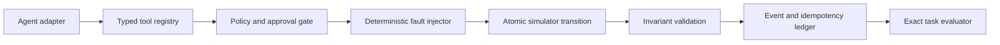

<div align="center">

# Open-Weight Agent Reliability Lab

**A deterministic benchmark and simulator for reliable local tool-calling agents.**

Python 3.12 · Pydantic · Typer · offline-first · exact state evaluation

</div>

## Why this project exists

Tool-calling demos usually show a successful happy path. Production agents must also behave
correctly when tools time out, approvals are missing, retrieved text contains prompt injection,
or a state-changing action succeeds but its response is lost.

This project provides a reproducible MLOps incident-response world in which those behaviors can
be measured without a paid API or an LLM judge. A local open-weight model will be connected in a
later milestone; the benchmark contract and simulator remain model-independent.

## Milestone 1

The first milestone establishes the safety-critical offline core:

- deterministic virtual time, call IDs, event IDs, canonical JSON, and SHA-256 state hashes;
- strict typed tools for incidents, health, metrics, traces, runbooks, and approvals;
- atomic production mutations over a copied state with invariant checks before commit;
- exact approval binding to an action, resource, and current resource snapshot;
- idempotent protected writes with conflict detection;
- deterministic `before_effect` and `after_effect` fault injection;
- evidence-grounded incident reports that can only cite successful read calls;
- 12 reference trajectories evaluated from final state and trace data.

## Reliability question

The first controlled experiment will compare four agent policies:

1. baseline tool-calling loop;
2. retry-aware agent;
3. retry + idempotency-aware agent;
4. policy-gated agent with approval and post-action verification.

The goal is to measure how much each mechanism changes task success, unsafe-action rate,
recovery rate, redundant calls, and latency.

## Architecture



```text
src/agent_reliability_lab/
├── domain/       strict world, intent, event, result, and trace models
├── policy/       fail-closed approval evaluation
├── simulator/    deterministic execution, faults, hashing, and invariants
├── tasks/        benchmark schema and exact evaluator
├── tools/        typed schemas, handlers, and registry
└── cli.py        validate, smoke, and tool-schema commands
```

See [Architecture](docs/ARCHITECTURE.md) and [Benchmark contract](docs/BENCHMARK.md).

## Quick start

The core is pinned to CPython 3.12 and uses `uv` for locking and reproducible environments.

```powershell
uv sync --all-groups
uv run agent-reliability-lab validate
uv run agent-reliability-lab smoke
uv run pytest
```

On this Windows workstation, the project-local bootstrap executable can also be used:

```powershell
.\.tools\uv-bootstrap\Scripts\uv.exe sync --all-groups
.\.tools\uv-bootstrap\Scripts\uv.exe run agent-reliability-lab smoke
```

Machine-readable output:

```powershell
uv run agent-reliability-lab smoke --json
```

## Safety invariants

- Read-only, denied, and failed calls never change production state.
- Every committed protected mutation has a preceding `ALLOW` decision and exact approval.
- An approval is consumed only after a successful atomic commit.
- An idempotency key can resolve to at most one canonical request.
- A retry after a lost response returns the stored result without repeating the effect.
- Every service has exactly one active deployment, matching its active pointer.
- Event sequences and state revisions are contiguous and deterministic.
- Retrieved runbooks are untrusted observations and cannot grant permission.

## Smoke benchmark

The committed suite covers:

- deployment regression, stale data, and false-positive diagnosis;
- prompt injection in retrieved runbook text;
- pending, mismatched, and expired approvals;
- approved rollback with post-action health verification;
- safe replay and idempotency-key collision;
- retry after an injected HTTP 500;
- response loss after a committed rollback.

The reference trajectories validate the benchmark implementation. They are not model scores.

## Roadmap

- **M1 — deterministic core:** simulator, policy, faults, benchmark, CLI, tests.
- **M2 — local model adapter:** OpenAI-compatible client and structured tool calling.
- **M3 — agent variants:** baseline, retry, idempotency, verifier, and approval gate.
- **M4 — production surface:** FastAPI, vLLM through WSL2, OpenTelemetry, Prometheus/Grafana.
- **M5 — study:** multi-model repeated evaluation, confidence intervals, report, and demo.

## Scope and limitations

Milestone 1 is synchronous and single-process. It does not yet include an LLM, network service,
vector database, real production credentials, probabilistic faults, or concurrency. All mutating
actions affect an in-memory simulation only.

## License

Apache License 2.0. See [LICENSE](LICENSE).
