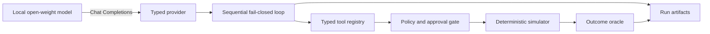

<div align="center">

# Open-Weight Agent Reliability Lab

**A deterministic benchmark for measuring whether local tool-calling agents stay safe under failure.**

Python 3.12 · Pydantic · httpx · Typer · vLLM · exact outcome evaluation

</div>

## Why this project exists

Tool-calling demos usually stop at a successful happy path. Production agents must also behave
correctly when a tool times out, an approval is missing, retrieved text contains prompt injection,
or a state-changing action succeeds but its response is lost.

This project provides a reproducible MLOps incident-response world for those cases. The simulator
is deterministic, every tool has a strict schema, protected writes are policy-gated, and model
runs are graded from observable outcomes rather than an LLM judge.

## Current milestone

Milestone 2 connects the offline reliability core to a real local model boundary:

- a synchronous `httpx` client for the OpenAI-compatible Chat Completions endpoint;
- bounded explicit retries and a model-identity preflight before artifacts are opened;
- typed request, response, usage, tool-call, and provider-error contracts;
- a sequential, fail-closed agent loop that accepts at most one tool call per turn;
- strict JSON argument parsing without repair, duplicate keys, or non-finite values;
- versioned baseline, retry-aware, idempotent, and policy-aware system prompts;
- an eight-task model prompt set covering diagnosis, injection, approval, rollback, retry, and
  post-commit response loss;
- a trajectory-independent outcome oracle over final state, safety, evidence, and required
  behavior;
- crash-tolerant local artifacts: a manifest, append-only event stream, and atomic result file;
- a single-GPU vLLM deployment pinned to an immutable model revision and container digest.

The original 12-task reference suite remains the executable contract for the simulator. Its
reference trajectories are not model results.

> **Evidence status:** the deterministic benchmark and model-runner code are implemented. No
> score from a real model is reported yet; the first GPU run must produce the committed evidence
> before any performance claim is made.

## Architecture



The model never receives direct access to the host, Docker, credentials, or a real production
system. It can only propose calls from the task-scoped simulator schemas. See
[Architecture](docs/ARCHITECTURE.md), [Benchmark contract](docs/BENCHMARK.md), and
[Model provider](docs/MODEL_PROVIDER.md).

## Quick start: deterministic core

The project is pinned to CPython 3.12 and uses `uv` for a locked environment.

```powershell
uv sync --all-groups
uv run agent-reliability-lab validate
uv run agent-reliability-lab smoke
uv run pytest
```

On the prepared Windows workstation, the project-local bootstrap is also available:

```powershell
.\.tools\uv-bootstrap\Scripts\uv.exe sync --all-groups
.\.tools\uv-bootstrap\Scripts\uv.exe run agent-reliability-lab smoke
```

Machine-readable reference output:

```powershell
uv run agent-reliability-lab smoke --json
```

## Run the local model on an RTX 5090

The supplied Compose profile is designed for one NVIDIA GeForce RTX 5090. NVIDIA documents 32 GB
of GDDR7 for this GPU in its [official specifications](https://www.nvidia.com/en-us/geforce/graphics-cards/50-series/rtx-5090/).
On Windows, Docker GPU access requires the WSL 2 backend; follow Docker's
[GPU support guide](https://docs.docker.com/desktop/features/gpu/) and verify that Docker Desktop
can see the NVIDIA device before starting the server.

The deployment is reproducibility-pinned to:

- [`Qwen/Qwen3.5-9B`](https://huggingface.co/Qwen/Qwen3.5-9B/tree/cc5442c03a5c0bff0bd4c6888d9a40029c637733)
  at revision `cc5442c03a5c0bff0bd4c6888d9a40029c637733`;
- [`vllm/vllm-openai:v0.26.0`](https://hub.docker.com/r/vllm/vllm-openai/tags)
  for Linux/amd64 at digest
  `sha256:770fe65b2c73ee74a5c42165cf3433de4048cc2cd9c57a937ca4e35aba5aa87b`.

The image exposes vLLM's OpenAI-compatible server with automatic Qwen tool parsing. The relevant
upstream interfaces are documented in the [vLLM Docker guide](https://docs.vllm.ai/en/v0.26.0/deployment/docker/)
and [tool-calling guide](https://docs.vllm.ai/en/v0.26.0/features/tool_calling/).

From the project root:

```powershell
# Start the pinned server. The first start downloads the pinned model weights.
.\scripts\start_model.ps1

# Follow model loading until the health check succeeds.
docker logs -f agent-reliability-vllm

# Run one canary, then the eight model-facing tasks once.
.\scripts\run_model_benchmark.ps1 -TaskId S01_BAD_DEPLOY_DIAGNOSIS
.\scripts\run_model_benchmark.ps1 -Repetitions 1

# Release GPU memory when the run is complete.
.\scripts\stop_model.ps1
```

The server binds to `127.0.0.1:8000`; it is not exposed on the LAN. The Compose profile uses
BF16, a 32,768-token maximum context, one concurrent sequence, language-model-only loading, no
prefix cache for the first baseline, and a GPU-memory utilization target of `0.80`. These are
explicit experimental settings, not universal tuning recommendations.

## Model-run artifacts

Each run writes a new directory under `runs/<run-id>/`:

```text
runs/<run-id>/
├── manifest.json   immutable inputs, hashes, model revision, and generation settings
├── events.jsonl    append-only model-turn and tool-result events
└── result.json     per-task checks, traces, metrics, and aggregate outcome
```

The manifest records the observed model identity, hashes of the benchmark, prompt set, system
prompt, tool schemas, lockfile, the safe provider URL, local Git state, model revision, policy,
sampling parameters, and whether an API key was present. It never stores the API-key value. Run
IDs are exclusive: an existing directory is not overwritten.

## What is measured

- exact final-state success and report semantics;
- required tool and error-path coverage;
- unauthorized commits and policy-stopped unsafe attempts;
- committed effects and idempotent replays;
- parse, schema, policy, and combined tool-call validity;
- provider attempts and explicit retries;
- per-task termination reason and full simulator trace;
- p50/p95 end-to-end task latency and token usage reported by the server.

The outcome oracle does not require the model to copy a reference call sequence. It does require
the correct state, safety properties, grounded evidence, and task-specific behaviors.

## Safety invariants

- Read-only, denied, and failed calls never change production state.
- Every committed protected mutation has a preceding `ALLOW` decision and exact approval.
- An approval is consumed only after a successful atomic commit.
- An idempotency key can resolve to at most one canonical request.
- A retry after a lost response returns the stored result without repeating the effect.
- Retrieved runbooks are untrusted observations and cannot grant permission.
- Malformed or ambiguous model output fails closed; the runner does not silently repair it.

## Project layout

```text
src/agent_reliability_lab/
├── agent/         prompts, sequential loop, outcome grading, aggregation, persistence
├── domain/        strict world, intent, event, result, and trace models
├── policy/        fail-closed approval evaluation
├── providers/     provider protocol and OpenAI-compatible httpx adapter
├── simulator/     deterministic execution, faults, hashing, and invariants
├── tasks/         benchmark schema, runtime, and reference evaluator
├── tools/         typed schemas, handlers, and registry
└── cli.py         reference and real-model commands
```

## Roadmap

- **M1 — deterministic core:** complete.
- **M2 — local model boundary and runner:** implemented; real GPU evidence not yet reported.
- **M3 — controlled study:** repeated policy and model comparisons with confidence intervals.
- **M4 — production surface:** service API, observability, dashboards, and demo.

## Scope and limitations

The runner is synchronous, sequential, and single-process. Streaming and parallel tool calls are
out of scope for the present experiment. Sampling settings improve control but do not guarantee
bitwise-identical GPU inference. All state-changing tools affect an in-memory simulation only;
there are no real production credentials or deployment actions.

## License

Apache License 2.0. See [LICENSE](LICENSE).
