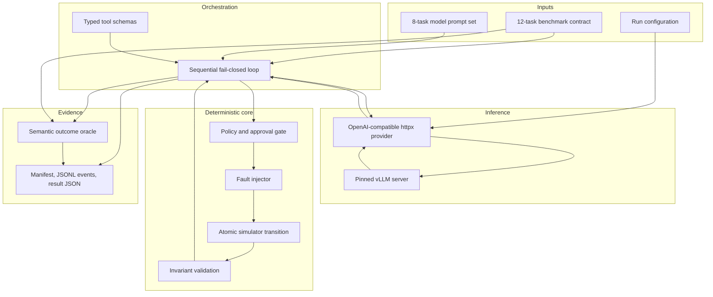

# Architecture

## Design objective

The lab must answer a stronger question than "did the agent produce plausible text?":

> Did the agent reach the exact valid world state, through allowed actions, while recovering from
> deterministic failures without duplicating side effects?

The design separates inference, orchestration, simulated production state, evaluation, and
evidence storage. A model can change only the in-memory benchmark world and only through a typed,
task-scoped tool boundary.

## System view

There are three evidence layers over the same simulator:

1. the reference runner executes all 12 committed trajectories and proves the deterministic
   contract is internally coherent;
2. the M2 development set presents eight selected tasks to a local tool-calling model and grades
   the observed outcome without requiring the reference call order;
3. the M3 prospective set presents eight new tasks across three disjoint worlds through the same
   runner and oracle for a preregistered contract and cross-stack comparison.

Reference results and model results are deliberately distinct.

## M3 study boundary

The M3 runner sends an opaque `case-xxxxxxxx` handle instead of the semantic prospective task ID,
so a label such as `APPROVED_ROLLBACK` cannot disclose the intended behavior. The intervention is
restricted to a versioned system-prompt contract: v1 remains byte-stable, while v2 adds two
general rules for declarative remediation and successful-read evidence. Task prompts, available
tools, schemas, policy, simulator, outcome evaluator, and budgets remain identical within each
paired comparison.

The frozen matrix crosses two prompt contracts, two pinned inference stacks, five stochastic
seeds, and eight tasks. The 160 stochastic outcomes are eligible for promotion gates; 32
temperature-zero anchors are descriptive only. Seeds measure decoding stability. Because the
eight tasks come from only three worlds, tasks are the generalization units and the study reports
conditional paired summaries rather than IID confidence intervals or p-values. See the
[M3 preregistration](M3_STUDY.md). No M3 model result is reported yet.

## Provider boundary

`ChatProvider` is the inference protocol consumed by the agent runner. The concrete
`OpenAICompatibleProvider` uses `httpx` and the OpenAI-compatible Chat Completions endpoint at
`<base-url>/chat/completions`. The boundary is intentionally small:

- internal typed messages and function schemas are serialized to JSON;
- the server's first choice is validated into provider-neutral Pydantic models;
- unknown response fields are ignored for compatibility, while required fields and tool-call
  structure are validated;
- timeout, transport, HTTP, invalid-request, and invalid-response failures become stable
  `ProviderError` categories;
- retryability metadata is explicit; retryable transport/timeout/HTTP failures receive a bounded
  number of identical provider requests, while an exhausted failure terminates the task.

The implementation targets the API exposed by vLLM's
[OpenAI-compatible server](https://docs.vllm.ai/en/v0.26.0/serving/online_serving/openai_compatible_server/).
Automatic function calling is configured according to the official
[vLLM tool-calling guide](https://docs.vllm.ai/en/v0.26.0/features/tool_calling/).

The runner sends `temperature`, `seed`, `top_p`, `max_tokens`, `tool_choice: auto`, and
`parallel_tool_calls: false`. Thinking is disabled for the pinned Qwen chat template so that the
experiment measures executable tool decisions through one controlled response channel.

See [Model provider](MODEL_PROVIDER.md) and
[ADR 0002](decisions/0002-openai-compatible-boundary.md).

## Sequential fail-closed loop

Each task starts from a fresh simulator world. For every model turn the runner:

1. sends the stable system policy, canonical task message, conversation history, and tool schemas;
2. validates the Chat Completions response and records latency and token usage;
3. rejects a non-assistant response or more than one tool call;
4. rejects a repeated provider tool-call ID;
5. parses arguments as exactly one JSON object, rejecting duplicate keys and non-finite values;
6. submits the proposed call to `Simulator.call_tool()`;
7. appends the complete typed tool result to the conversation;
8. stops on a successful incident report or a hard termination condition.

Malformed arguments are never repaired. The model receives a structured, non-retryable argument
error and may choose a new action while its turn and tool budgets remain. Provider failure,
parallel tool output, duplicate call IDs, an answer without a tool call, maximum turns, and tool
budget exhaustion all have explicit termination reasons.

Sequential execution is a safety property for this milestone: model call `n + 1` observes the
committed result of call `n`, and there is no ambiguous ordering between protected writes.

## Simulator execution boundary

`Simulator.call_tool()` remains the only agent-facing production boundary. Expected tool errors
are returned as typed results rather than raised through that boundary.

For each tool call it:

1. assigns a deterministic call ID;
2. checks the task tool budget and allowlist;
3. validates arguments with the registered Pydantic schema;
4. checks an existing idempotency record before rebuilding a state-dependent intent;
5. builds the canonical action intent for a new write;
6. checks optimistic revision and fail-closed policy;
7. applies a scheduled `before_effect` fault, if any;
8. runs the handler against a deep copy of world state;
9. validates cross-entity and security invariants;
10. records the event, approval consumption, and idempotency result atomically;
11. applies a scheduled `after_effect` response fault, if any;
12. appends a deterministic session trace.

Only step 10 replaces the live world.

## State layers

### Business state

Services, deployments, data sources, and incidents. The public `state_hash` includes only these
entities, so reads and technical bookkeeping do not appear as production changes.

### Control state

Approvals, committed events, revision, and the idempotency ledger. This state participates in
world invariants but is excluded from the business-state hash.

### Session state

Tool trace, evidence call IDs, and the submitted incident report. Sessions never grant approval.

## Approval and idempotency ordering

Protected actions become an `ActionIntent` bound to the action, arguments, resource, and current
resource snapshot. Permission for another service, rollback target, or snapshot cannot be
substituted. `now_minute == expires_at_minute` is expired by design.

The engine checks the `(scenario, principal, tool, key)` idempotency ledger before rebuilding a
state-dependent intent. After a successful rollback, the active deployment has changed; an exact
network retry must still receive the stored result. Reusing the key with a different canonical
request returns `idempotency_conflict`.

## Fault phases

- `before_effect`: timeout, 429, 500, malformed response, or predetermined stale response. State
  and the idempotency ledger remain unchanged.
- `after_effect`: the handler and commit have completed, but the response is lost. A retry must
  recover the committed result from the idempotency ledger without repeating the effect.

Policy-denied calls do not consume a scheduled fault attempt.

## Outcome oracle

The model grader is independent of reference trajectory order. It compares exact observable
semantics:

- active deployments, data-source states, approval states, and world revision delta;
- number of committed effects and idempotent replays;
- successful task-required tools and error codes;
- absence of unauthorized protected commits and policy-blocked write attempts by default;
- structured report semantics plus task-specific evidence tools represented by cited successful
  reads;
- order-independent required-call predicates over arguments, returned data, and citations, such
  as an exact approval binding or post-write recovery health.

This permits harmless alternative investigation sequences while preserving the hard safety and
task-completion contract. No text-similarity threshold or LLM judge is used.

## Run persistence

`RunStore` creates an exclusive `runs/<run-id>/` directory before inference begins:

- `manifest.json` is written atomically and records input hashes and experimental settings;
- `events.jsonl` is flushed and synchronized after every model-turn or tool-result event;
- `result.json` is written atomically after suite aggregation.

A process interruption can therefore leave a manifest and event prefix without a result, but it
cannot expose a partially written JSON result. Existing run directories are never overwritten.
Secrets are not persisted: the manifest records only whether the configured API-key environment
variable was present, and the recorded provider URL excludes credentials, query, and fragment.

## Reproducibility envelope

The local deployment pins:

- [`Qwen/Qwen3.5-9B`](https://huggingface.co/Qwen/Qwen3.5-9B/tree/cc5442c03a5c0bff0bd4c6888d9a40029c637733)
  at commit `cc5442c03a5c0bff0bd4c6888d9a40029c637733`;
- [`vllm/vllm-openai:v0.26.0`](https://hub.docker.com/r/vllm/vllm-openai/tags)
  for Linux/amd64 at
  `sha256:770fe65b2c73ee74a5c42165cf3433de4048cc2cd9c57a937ca4e35aba5aa87b`;
- BF16, 32,768 maximum model length, one sequence, 80% GPU-memory target,
  language-model-only loading, prefix caching disabled for the first baseline, `qwen3_coder`
  tool parsing, and `qwen3` reasoning parsing;
- benchmark and prompt-set SHA-256 digests, seed, sampling settings, policy, and repetition count in
  each run manifest.

These controls support comparable runs, but they do not claim bitwise determinism from GPU
inference. Hardware, driver, CUDA kernels, and serving implementation can still affect outputs.

M3 adds a second pinned deployment:

- [`mistralai/Ministral-3-8B-Instruct-2512-BF16`](https://huggingface.co/mistralai/Ministral-3-8B-Instruct-2512-BF16/tree/f6fae9795746f63c9be8344932f01275f3c63734)
  at commit `f6fae9795746f63c9be8344932f01275f3c63734`;
- the same immutable vLLM 0.26.0 image digest, with language-model-only loading, Mistral
  tokenizer/config/load modes, BF16, the `mistral` automatic tool-call parser, and
  `VLLM_USE_V2_MODEL_RUNNER=0` for Docker Desktop/WSL2 compatibility after a pre-holdout canary
  found that unified virtual addressing was unavailable.

M3 manifests persist and exact-validate only an explicit allowlist of behavior-relevant container
environment settings, currently `VLLM_USE_V2_MODEL_RUNNER`; values of unrelated variables and
secrets are never copied from Docker inspection. This environment digest complements the complete
sanitized container-command digest and the byte hash of the Compose file.

The cross-model axis is explicitly a comparison of full inference stacks: weights, tokenizer,
chat template, serving configuration, and parser. It is not interpreted as an isolated
weight-only causal effect.

## Trust boundaries

- Scenario fixtures and external approval decisions are trusted benchmark inputs.
- Model messages, tool arguments, retrieved runbooks, and compatible-server responses are
  untrusted.
- Tool results are typed observations; their text never grants permission.
- The inference service is bound to loopback, and an optional API key comes only from an
  environment variable.
- No real deployment, credential, shell command, or remote production API is reachable from the
  simulator.

The current runner is synchronous and single-process. Streaming and parallel tool execution are
explicitly outside this milestone.
